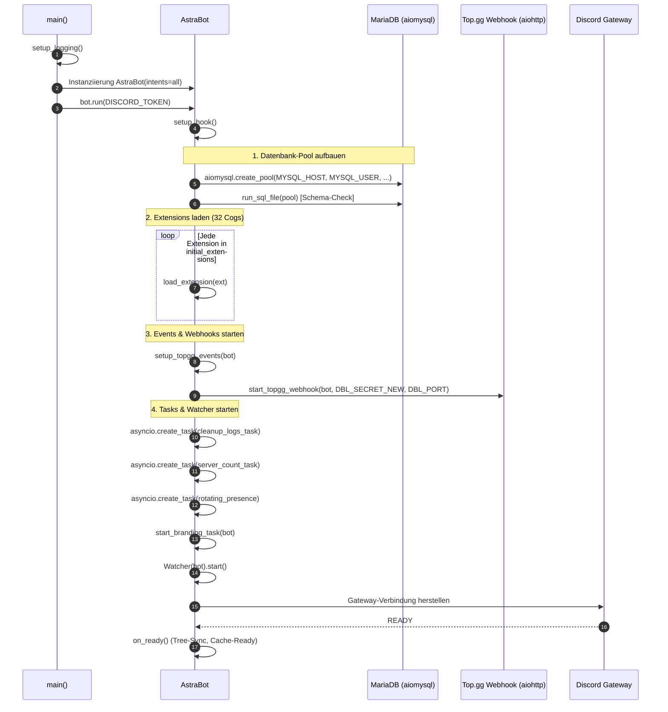
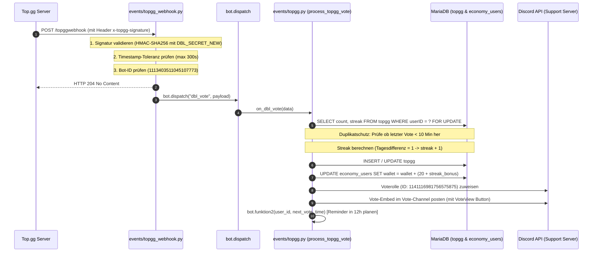
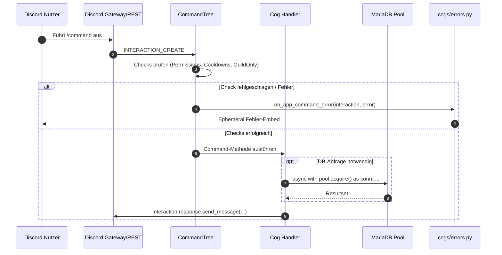
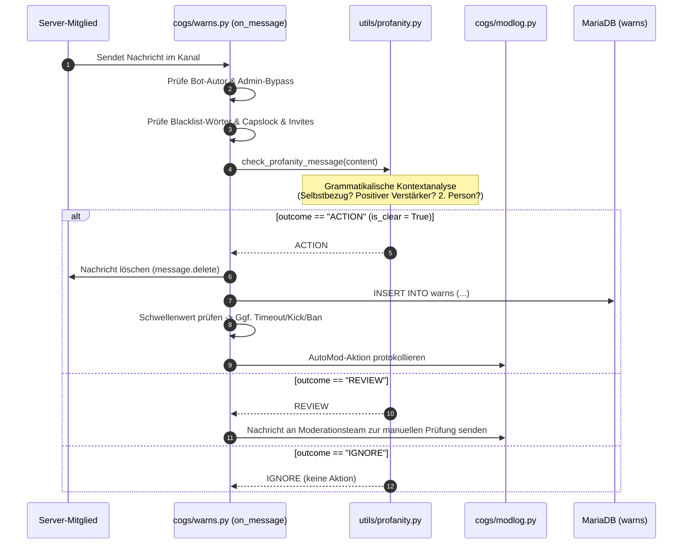

# Astra Bot – Vollständige Technische Dokumentation

Diese Dokumentation beschreibt den exakten **IST-Zustand** des Discord-Bots **Astra** auf Basis einer vollständigen statischen Quellcode- und Konfigurationsanalyse des gesamten Repositorys.

---

## Inhaltsverzeichnis

1. [Vollständige Projektübersicht](#1-vollständige-projektübersicht)
   - [1.1 Verzeichnisstruktur](#11-verzeichnisstruktur)
   - [1.2 Dateien und funktionale Rollen](#12-dateien-und-funktionale-rollen)
   - [1.3 Zusammenspiel der Projektbereiche](#13-zusammenspiel-der-projektbereiche)
2. [Hauptarchitektur und Bot-Lifecycle](#2-hauptarchitektur-und-bot-lifecycle)
   - [2.1 Bot-Klasse AstraBot und Initialisierung](#21-bot-klasse-astrabot-und-initialisierung)
   - [2.2 Lifecycle und Startup-Reihenfolge](#22-lifecycle-und-startup-reihenfolge)
   - [2.3 Background Tasks, Event-Registrierung und DB-Initialisierung](#23-background-tasks-event-registrierung-und-db-initialisierung)
   - [2.4 Fehlerbehandlung, Logging, Shutdown und Cleanup](#24-fehlerbehandlung-logging-shutdown-und-cleanup)
3. [Sämtliche Cogs und Features](#3-sämtliche-cogs-und-features)
   - [3.1 Detaillierte Analyse aller 34 Cogs](#31-detaillierte-analyse-aller-34-cogs)
4. [Events und externe Integrationen](#4-events-und-externe-integrationen)
   - [4.1 Event-Handler und Dispatching](#41-event-handler-und-dispatching)
   - [4.2 Top.gg Webhook und Vote-Pipeline](#42-topgg-webhook-und-vote-pipeline)
5. [Utilities und Hintergrundsysteme](#5-utilities-und-hintergrundsysteme)
   - [5.1 Modulübersicht utils](#51-modulübersicht-utils)
6. [Datenbankdokumentation](#6-datenbankdokumentation)
   - [6.1 Tabellenverzeichnis und Spalten](#61-tabellenverzeichnis-und-spalten)
   - [6.2 System-Matrix](#62-system-matrix)
   - [6.3 Transaktionen, Pooling und Migrationen](#63-transaktionen-pooling-und-migrationen)
7. [Konfiguration und Umgebungsvariablen](#7-konfiguration-und-umgebungsvariablen)
   - [7.1 Env-Variablen-Referenz](#71-env-variablen-referenz)
8. [Externe Dienste und Infrastruktur](#8-externe-dienste-und-infrastruktur)
9. [Abhängigkeiten](#9-abhängigkeiten)
10. [Kritische Abläufe und Datenflüsse](#10-kritische-abläufe-und-datenflüsse)
    - [10.1 Slash-Command Verarbeitung](#101-slash-command-verarbeitung)
    - [10.2 AutoMod und Profanity Pipeline](#102-automod-und-profanity-pipeline)
11. [Fehlerbehandlung und Stabilität](#11-fehlerbehandlung-und-stabilität)
12. [Technische Besonderheiten und Architekturentscheidungen](#12-technische-besonderheiten-und-architekturentscheidungen)
13. [Offene Punkte, Diskrepanzen und Technische Risiken](#13-offene-punkte-diskrepanzen-und-technische-risiken)

---

## 1. Vollständige Projektübersicht

### 1.1 Verzeichnisstruktur

```
Astra Repo/
├── .astra_branding_state.json      # Lokaler Persistenzstatus für saisonales Branding (generiert)
├── main.py                         # Zentraler Einstiegspunkt, Bot-Klasse, Lifecycle, Startup & Shutdown
├── README.md                       # Projektübersicht & Feature-Liste
├── requirements.txt                # Externe Python-Abhängigkeiten
├── wanted.jpg                      # Grafik-Asset (Template für Fun-Command /wanted)
├── cogs/                           # Modularisierte Discord-Erweiterungen (Cogs)
│   ├── .env                        # Lokale/Vorhandene Environment-Konfiguration
│   ├── afk.py                      # AFK-System & Erwähnungs-Benachrichtigungen
│   ├── astra.py                    # Meta-Informationen zum Bot (About, Invite, Support, Ping, Uptime)
│   ├── autoreact.py                # Automatisches Reagieren auf Trigger-Wörter mit Emojis
│   ├── autorole.py                 # Automatische Rollenzuweisung bei Serverbeitritt
│   ├── backups.py                  # Server-Backup- & Wiederherstellungssystem (Channels, Rollen, Struktur)
│   ├── birthday.py                 # Geburtstagsverwaltung & -glückwünsche
│   ├── counting.py                 # Zählspiel-Kanal mit Prüflogik
│   ├── dev.py                      # Entwickler-/Owner-Tools, Debugging, Eval, Shell, System-Info
│   ├── economy.py                  # Vollständiges Wirtschaftssystem (Wallet, Bank, Jobs, Minispiele, Cooldowns)
│   ├── emojiquiz.py                # Automatisches Emoji-Quizspiel in dediziertem Kanal
│   ├── errors.py                   # Globaler Error-Handler für Application Commands
│   ├── fun.py                      # Spaß- & Bildbearbeitungsbefehle (Pillow-Manipulation, Memes, Utility)
│   ├── giveaway.py                 # Verlosungssystem mit XP-/Nachrichten-Bedingungen
│   ├── goals.py                    # Community-Ziele (Member, Voice, Messages, Slash-Commands)
│   ├── guessthenumber.py           # Zahlenratespiel (Guess the Number)
│   ├── hangman.py                  # Galgenmännchen-Spiel via Discord UI Buttons
│   ├── help.py                     # Dynamisches Hilfemenü mit Select-Menüs & Caching
│   ├── leave.py                    # Abschiedsnachrichten (Leave-Messages)
│   ├── levels.py                   # XP- & Levelsystem mit Rangkarte (Pillow), Styles & Level-Rollen
│   ├── meta.py                     # Informationsbefehle (Userinfo, Serverinfo, Channelinfo, Weather, Polls)
│   ├── mod.py                      # Moderationsbefehle (Ban, Kick, Clear, Embedfy, User-Reports)
│   ├── modlog.py                   # Audit-Logging für Server- und Nachrichten-Events
│   ├── notifier.py                 # YouTube/Twitch/Social-Media Notifier Background-Loop
│   ├── partner.py                  # Partnerschaftsverwaltung & Bewerbungssystem (nicht in initial_extensions)
│   ├── reactionrole.py             # Reaktionsrollen-System
│   ├── reminder.py                 # Erinnerungssystem mit Zeit-Parsing & DMs
│   ├── snake.py                    # Snake-Minispiel mit UI-Steuerung
│   ├── stats.py                    # Server- & Nutzeraktivitäts-Statistiken (Voice, Message, Tracking)
│   ├── tags.py                     # Tag-/Custom-Command-System mit Platzhaltern
│   ├── tempchannel.py              # Temporäre Sprachkanäle (Join-to-Create) mit dynamischem Control-Panel
│   ├── ticket.py                   # Ticket-System mit Transkripten, Select-Menüs & Auto-Close-Task
│   ├── uno.py                      # UNO-Kartenspiel (nicht in initial_extensions)
│   ├── warns.py                    # Verwarnungssystem, AutoMod (Badwords, Capslock, Invites, Profanity)
│   ├── welcome.py                  # Willkommensnachrichten mit konfigurierbarem Banner (Pillow)
│   └── assets/                     # Grafische Ressourcen für Cogs
│       ├── Profilbilder/           # Saisonale Bot- & Server-Avatare (Idee_2_blau.jpg, Astra_halloween.jpg, etc.)
│       ├── Levelcards/             # Vorlagen und Texturen für Level- und Rang-Karten (Standard, Streifen, saisonal)
│       ├── Welcomecards/           # Hintergrundvorlagen für Willkommens-Banner
│       └── banner.svg              # Vektorgrafik-Asset
├── events/                         # Externe Event-Integrationen und Webhook-Server
│   ├── topgg.py                    # Top.gg Event-Verarbeitung (`on_dbl_vote`, `on_dbl_test`, Belohnungen, Streaks)
│   └── topgg_webhook.py            # Aiohttp-Webhook-Server für Top.gg mit HMAC-SHA256-Signaturprüfung
└── utils/                          # Hilfsmodule & Subsysteme
    ├── branding.py                 # Saisonales Profilbild-/Farbmanagement & automatischer Wechsel
    ├── cleanup.py                  # Hintergrund-Task zur Bereinigung alter Bot-Logs
    ├── db_scheme.py                # SQL-Parser & dynamische Schema-Migrationslogik
    ├── file_watcher.py             # Watchdog-Dateiwächter für automatischen Cog-Reload / Systemd-Restart
    ├── logger.py                   # Konfiguration des Python-Loggings mit HTTP-/Noise-Filtern
    ├── presence.py                 # Dynamische rotierende Rich Presence (Stats & Zeitsteuerung)
    └── profanity.py                # Mehrsprachiger, kontextsensitiver Beleidigungs- & Filter-Algorithmus
```

### 1.2 Dateien und funktionale Rollen

| Datei / Pfad | Kategorie | Funktionale Rolle & Verantwortlichkeit |
|---|---|---|
| `main.py` | Einstiegspunkt | Initialisiert den Bot `AstraBot`, baut den MariaDB-Connection-Pool auf, führt automatische SQL-Migrationen durch, lädt die Cogs, startet Background-Tasks und registriert Shutdown-Handler. |
| `requirements.txt` | Konfiguration | Definiert alle externen Python-Abhängigkeiten mit Versionspins (z. B. `discord.py`, `aiomysql`, `aiohttp`, `Pillow`, `watchdog`). |
| `README.md` | Dokumentation | Öffentliche Feature- und Modulübersicht des Astra Discord-Bots. |
| `wanted.jpg` | Asset | Bildvorlage für den Bildmanipulationsbefehl `/wanted` aus `cogs/fun.py`. |
| `.astra_branding_state.json` | Cache / Status | Persistiert den zuletzt aktiven saisonalen Branding-Status (z. B. Halloween, Weihnachten, Standard), um unnötige API-Aufrufe bei Neustarts zu vermeiden. |
| `cogs/` | Module (Cogs) | Beherbergt sämtliche 34 modularen Discord-Erweiterungen mit Slash-Commands, Event-Listenern, UI-Komponenten (Buttons, Menüs, Modals) und cog-spezifischen Hintergrundaufgaben. |
| `cogs/.env` | Konfiguration | Lokale Umgebungskonfiguration für Entwicklungs- oder Deployment-Variablen. |
| `cogs/assets/` | Ressourcen | Beinhaltet Subdirectories und Assets: `Profilbilder/` (saisonale Avatare), `Levelcards/` (Rang- & Levelkarten-Hintergründe), `Welcomecards/` (Willkommensbanner) sowie `banner.svg`. |
| `events/` | Integrationen | Externe Schnittstellen und Webhook-Empfänger: `topgg_webhook.py` (Aiohttp-Server mit HMAC-Signaturprüfung) und `topgg.py` (Vote-Verarbeitung, Belohnungen, Streaks). |
| `utils/` | Hilfsdienste | Querschnittliche Subsysteme: Branding-Automation (`branding.py`), Log-Bereinigung (`cleanup.py`), dynamisches DB-Schema (`db_scheme.py`), File-Watcher (`file_watcher.py`), Logging-Filter (`logger.py`), Rich Presence (`presence.py`) und Profanity-Filter (`profanity.py`). |

### 1.3 Zusammenspiel der Projektbereiche

Das Astra-Repository ist modular in vier Hauptschichten aufgebaut:

1. **Orchestrierung & Lifecycle (`main.py`):**
   - Dient als zentraler Knotenpunkt. Verwaltet den Lebenszyklus des Bots von der Instanziierung bis zum ordnungsgemäßen Herunterfahren.
   - Hält die globale Datenbankverbindung (`bot.pool`), die von allen Cogs und Events mitgenutzt wird.
2. **Modulare Feature-Layer (`cogs/`):**
   - Jedes Cog kapselt einen in sich geschlossenen Funktionsbereich (z. B. `cogs/economy.py`, `cogs/ticket.py`, `cogs/levels.py`).
   - Cogs kommunizieren mit Discord über den `discord.app_commands.CommandTree` und reagieren auf Gateway-Events über Cog-Listener.
   - Bildgenerierungsmodule greifen direkt auf Vorlagen in `cogs/assets/` oder `wanted.jpg` zu.
3. **Externe Integrationen (`events/`):**
   - Entkoppelt externe Webhook-Aufrufe (Top.gg) vom Discord-Gateway. Eingehende HTTP-Anfragen werden verifiziert und über `bot.dispatch("dbl_vote", payload)` an Event-Handler weitergeleitet.
   - Greift auf `bot.pool` zu, um Belohnungen in `economy_users` und Streaks in `topgg` zu aktualisieren.
4. **Querschnittliche Hilfsdienste (`utils/`):**
   - Stellt modulübergreifende Logik bereit (Schema-Migrationen, Logging-Filter, Schimpfwort-Prüfungen, Presence-Updates).
   - Der Dateiwächter (`file_watcher.py`) beobachtet das Dateisystem und lädt geänderte Cogs zur Laufzeit automatisch neu (`bot.reload_extension`).

---

## 2. Hauptarchitektur und Bot-Lifecycle

### 2.1 Bot-Klasse AstraBot und Initialisierung

In `main.py` wird die zentrale Bot-Klasse `AstraBot` als Unterklasse von `discord.ext.commands.Bot` definiert.

- **Intents:** `discord.Intents.all()` (erfordert in Discord Developer Portal: `GUILD_MEMBERS`, `MESSAGE_CONTENT`, `GUILD_PRESENCES`).
- **Command Prefix:** `+` (primär für Legacy-/Dev-Commands, Hauptinteraktion erfolgt über Slash-Commands / Application Commands).
- **Attribute der Bot-Instanz:**
  - `bot.pool`: Asynchroner MariaDB/MySQL-Connection-Pool (`aiomysql.Pool`).
  - `bot.runner`: Aiohttp-Runner des Top.gg-Webhook-Servers.
  - `bot.watcher`: Watchdog `Watcher`-Instanz für automatische Code-Aktualisierungen.
  - `bot.tasks`: Liste aktiver `asyncio.Task`-Referenzen für Hintergrundroutinen.
  - `bot.funktion2`: Asynchrone Hilfsmethode zur Registrierung von Top.gg-Vote-Erinnerungen (`cogs.reminder.add_reminder`).

### 2.2 Lifecycle und Startup-Reihenfolge



#### Ablauf im Detail:
1. **`main()`:** Initialisiert das Logging über `utils.logger.setup_logging()`. Erstellt die Instanz `AstraBot` und ruft `bot.run(TOKEN)` auf.
2. **`setup_hook()`:**
   - Erstellt den MySQL-Pool `aiomysql.create_pool(minsize=5, maxsize=20, autocommit=True, ...)`.
   - Führt `utils.db_scheme.run_sql_file(self.pool)` aus, um fehlende Tabellen oder Spalten zu migrieren.
   - Lädt sequenziell alle 32 in `initial_extensions` definierten Cogs.
   - Registriert Top.gg-Event-Handler via `events.topgg.setup_topgg_events(self)`.
   - Startet den Aiohttp-Server für Top.gg-Webhooks via `events.topgg_webhook.start_topgg_webhook(...)`.
   - Startet Hintergrundtasks: `cleanup_logs_task`, `server_count_task`, `rotating_presence`, `start_branding_task`.
   - Startet den Dateiwächter `Watcher(self).start()`.
3. **`on_ready()`:**
   - Synchronisiert die Application Commands global mit Discord (`await self.tree.sync()`).
   - Schreibt Status-Logmeldungen mit Server-, User- und Latenzangaben.
4. **Shutdown & Cleanup (`close()`):**
   - Schließt den Datenbank-Pool geordnet (`self.pool.close()`, `await self.pool.wait_closed()`).
   - Stoppt den Top.gg-Webhook-Server (`await self.runner.cleanup()`).
   - Stoppt den Watchdog-Observer (`self.watcher.stop()`).
   - Stoppt den saisonalen Branding-Task (`utils.branding.stop_branding_task()`).
   - Bricht alle registrierten Hintergrundtasks (`bot.tasks`) über `task.cancel()` ab.
   - Ruft `super().close()` auf.

### 2.3 Background Tasks, Event-Registrierung und DB-Initialisierung

Im Verlauf des Starts (`setup_hook()`) werden folgende Hintergrund- und Initialisierungsdienste gestartet:

1. **Datenbank-Pool & Schema-Prüfung:**
   - Erstellung des asynchronen Verbindungspools: `aiomysql.create_pool(minsize=5, maxsize=20, autocommit=True, ...)`.
   - Aufruf von `utils.db_scheme.run_sql_file(self.pool)` zur Validierung und dynamischen Migration fehlender Tabellen/Spalten anhand von `opt/schema.sql`.
2. **Hintergrund-Tasks (`asyncio.create_task`):**
   - `cleanup_logs_task(bot)` (`utils/cleanup.py`): Bereinigt stündlich veraltete Bot-Logs (`bot_logs`), die älter als 7 Tage sind.
   - `server_count_task(bot)` (`main.py`): Schreibt die aktuelle Serveranzahl in `servercount` und aktualisiert `website_stats`.
   - `rotating_presence(bot)` (`utils/presence.py`): Rotiert alle 30 Sekunden die Rich Presence zwischen 4 Aktivitäten und wechselt nachts (00:00–06:00 Berlin) auf Status `idle`.
   - `start_branding_task(bot)` (`utils/branding.py`): Prüft täglich um 00:00 Uhr Berlin-Zeit anstehende Feiertage/Events (Ostern, Halloween, Weihnachten) und tauscht Avatar und Server-Icon automatisch aus.
3. **Event-Registrierung & Top.gg Webhook-Server:**
   - Registrierung der Event-Handler via `events.topgg.setup_topgg_events(self)`.
   - Starten des Aiohttp-Webhook-Servers auf Port `DBL_PORT` (Standard: 5000) mit `events.topgg_webhook.start_topgg_webhook(...)`.
4. **Hot-Reloading Dateiwächter:**
   - Start des Watchdog-Observers `Watcher(self).start()` (`utils/file_watcher.py`) zur Überwachung von Dateiänderungen.

### 2.4 Fehlerbehandlung, Logging, Shutdown und Cleanup

1. **Globales Exception-Handling:**
   - `cogs/errors.py` fängt Fehler aus Slash-Commands (`on_app_command_error`) zentral ab und sendet verständliche, ephemere Fehlermeldungen (z. B. fehlende Rechte, Cooldowns, Check-Fehler).
2. **Strukturiertes Logging (`utils/logger.py`):**
   - Zentrales Log-Format `%(asctime)s | %(levelname)-5s | %(message)s`.
   - Eigener Log-Filter `CleanLogs`, der bösartige/nutzlose HTTP-Scanner-Anfragen (`/.well-known/`, `/favicon.ico`) und Webhook-Noise herausfiltert.
3. **Geordneter Shutdown (`close()` in `main.py`):**
   - Geordnetes Schließen des Datenbank-Pools (`self.pool.close()`, `await self.pool.wait_closed()`).
   - Herunterfahren des Top.gg Webhook-Webservers (`await self.runner.cleanup()`).
   - Beenden des Watchdog-Dateiwächters (`self.watcher.stop()`).
   - Stoppen des saisonalen Branding-Tasks (`utils.branding.stop_branding_task()`).
   - Abbruch aller verbleibenden Tasks in `self.tasks` via `task.cancel()`.
   - Aufruf von `super().close()` zur sauberen Trennung vom Discord-Gateway.

---

## 3. Sämtliche Cogs und Features

Im Repository existieren **34 Cog-Dateien** unter `cogs/`. 32 davon werden in `main.py` standardmäßig geladen; 2 Cogs (`partner.py`, `uno.py`) sind im Quellcode vorhanden, aber nicht in `initial_extensions` eingetragen.

### 3.1 Detaillierte Analyse aller 34 Cogs

#### 1. `cogs/afk.py`
- **Klasse:** `afk(commands.Cog)`
- **Aufgabe:** Verwaltet den AFK-Status von Nutzern. Setzt Status bei Befehlsaufruf und entfernt ihn bei der nächsten Nachricht. Benachrichtigt Erwähner in Channel/DM.
- **Commands:**
  - `/afk [grund]` (Slash-Command, Guild-only): Setzt den AFK-Status mit optionaler Begründung.
- **Events & Listeners:**
  - `@commands.Cog.listener() on_message(message)`:
    - Entfernt AFK-Status des Autors, wenn er eine Nachricht schreibt.
    - Benachrichtigt Autoren, falls sie einen AFK-Nutzer pingen (mit Zeitangabe & Grund).
- **Datenbankzugriff:**
  - Tabellen: `afk` (`guild_id`, `user_id`, `grund`, `time`, `dm`)
  - Operationen: `SELECT`, `INSERT ON DUPLICATE KEY UPDATE`, `DELETE`.
- **Besonderheiten:** Berechnet verstrichene AFK-Dauer dynamisch (`<t:{time}:R>`).

#### 2. `cogs/astra.py`
- **Klasse:** `astra(commands.Cog)`, `testbutton(discord.ui.View)`
- **Aufgabe:** Allgemeine Metadaten, Informations- und Statusbefehle des Bots.
- **Commands:**
  - `/about`: Zeigt allgemeine Bot-Informationen, Entwickler, Version, Bibliotheken und Support-Links.
  - `/invite`: Liefert den OAuth2-Einladungslink für Astra mit erforderlichen Berechtigungen.
  - `/support`: Sendet einen Einladungslink zum offiziellen Support-Server.
  - `/ping`: Misst WebSocket-Latenz und REST-API-Roundtrip-Zeit.
  - `/uptime`: Zeigt die aktuelle Laufzeit seit dem letzten Start.
- **Events & Listeners:**
  - `on_guild_join(guild)`: Protokolliert Server-Beitritte und aktualisiert Statistiken.
  - `on_guild_remove(guild)`: Protokolliert Server-Verlassen.
- **Datenbankzugriff:** Keine direkten Tabellenoperationen (liest `bot.pool` / `bot.uptime`).

#### 3. `cogs/autoreact.py`
- **Klasse:** `autoreact(commands.Cog)`
- **Aufgabe:** Automatische Emoji-Reaktionen auf konfigurierte Schlüsselwörter.
- **Commands:**
  - `/autoreact add <wort> <emoji>` (Permissions: `manage_guild`): Fügt ein Trigger-Wort mit zugehörigem Emoji hinzu.
  - `/autoreact remove <wort>`: Entfernt eine Auto-Reaktion.
  - `/autoreact list`: Listet alle aktiven Auto-Reaktionen des Servers auf.
- **Events & Listeners:**
  - `on_message(message)`: Prüft eingehende Nachrichten auf registrierte Trigger-Wörter und setzt Reaktionen via `message.add_reaction()`.
- **Datenbankzugriff:**
  - Tabellen: `autoreact` (`guild_id`, `word`, `emoji`)
  - Operationen: `SELECT`, `INSERT`, `DELETE`.

#### 4. `cogs/autorole.py`
- **Klasse:** `autorole(commands.Cog)`
- **Aufgabe:** Automatische Zuweisung einer oder mehrerer Rollen beim Beitritt neuer Mitglieder oder Bots.
- **Commands:**
  - `/autorole set <rolle> [bot_rolle]`: Konfiguriert User- und optionale Bot-Rollen.
  - `/autorole remove`: Deaktiviert das Auto-Role-System.
  - `/autorole status`: Zeigt die aktuell konfigurierten Rollen.
- **Events & Listeners:**
  - `on_member_join(member)`: Unterscheidet zwischen Bot und regulärem Nutzer und weist die hinterlegte Rolle via `member.add_roles()` zu.
- **Datenbankzugriff:**
  - Tabellen: `autorole` (`guild_id`, `role_id`, `bot_role_id`)
  - Operationen: `SELECT`, `INSERT ON DUPLICATE KEY UPDATE`, `DELETE`.

#### 5. `cogs/backups.py`
- **Klassen:** `backups(commands.Cog)`, `ConfirmView`, `RestoreModal`
- **Aufgabe:** Vollständiges Backup- und Wiederherstellungssystem für Server (Rollen, Rollen-Hierarchie, Permissions, Kategorien, Text-/Voice-Kanäle, Channel-Overwrites, Servereinstellungen).
- **Commands (Gruppe `/backup`):**
  - `/backup create`: Erstellt ein Snapshot-Backup des Servers und generiert eine Backup-ID.
  - `/backup list`: Listet alle für den Server oder User erstellten Backups auf.
  - `/backup load <backup_id>`: Stellt einen Server anhand eines Backups wieder her.
  - `/backup undo`: Macht die letzte Wiederherstellung rückgängig (sofern Snapshot vorhanden).
  - `/backup status`: Zeigt den Status laufender Backup-Jobs.
  - `/backup delete <backup_id>`: Löscht ein gespeichertes Backup.
  - `/backup export <backup_id>`: Exportiert die JSON-Backup-Daten.
  - `/backup import`: Importiert Backup-Daten.
- **Datenbankzugriff:**
  - Tabellen: `backups` (`backup_id`, `guild_id`, `creator_id`, `created_at`, `data`), `backup_jobs` (`job_id`, `guild_id`, `status`, `progress`).
  - Operationen: `SELECT`, `INSERT`, `UPDATE`, `DELETE`.
- **Besonderheiten:** Nutzt Semaphore und asynchrone Jobs, um Discord-Rate-Limits beim Erstellen von Dutzenden Kanälen und Rollen einzuhalten.

#### 6. `cogs/birthday.py`
- **Klassen:** `birthday(commands.Cog)`, `BirthdayModal`
- **Aufgabe:** Speichert Geburtstage von Servermitgliedern und gratuliert am jeweiligen Tag in einem konfigurierten Kanal.
- **Commands (Gruppe `/geburtstag`):**
  - `/geburtstag setzen <tag> <monat> [jahr]`: Speichert den Geburtstag des Nutzers.
  - `/geburtstag anzeigen [user]`: Zeigt den eingetragenen Geburtstag an.
  - `/geburtstag loeschen`: Löscht den eigenen Eintrag.
  - `/geburtstag nachricht <kanal> [rolle] [nachricht]`: Konfiguriert den Gratulationskanal und die Glückwunsch-Nachricht.
  - `/geburtstag status`: Zeigt Einstellungen für den Server.
- **Hintergrundtasks:**
  - `@tasks.loop(time=...)`: Prüft täglich um Mitternacht, welche Nutzer heute Geburtstag haben, und sendet Embeds/Pings.
- **Datenbankzugriff:**
  - Tabellen: `birthday_settings` (`guild_id`, `channel_id`, `role_id`, `message`), `birthdays_guild` (`user_id`, `guild_id`, `day`, `month`, `year`).
  - Operationen: `SELECT`, `INSERT ON DUPLICATE KEY UPDATE`, `DELETE`.

#### 7. `cogs/counting.py`
- **Klasse:** `counting(commands.Cog)`
- **Aufgabe:** Dedizierter Zählkanal (1, 2, 3...). Verhindert Doppelzählen derselben Person, falsche Zahlen und resettet bei Fehlern.
- **Commands:**
  - `/counting setup <channel>` (Permissions: `manage_guild`): Richtet den Zählkanal ein.
  - `/counting status`: Zeigt aktuelle Zählnummer und Highscore.
  - `/counting reset`: Setzt den Zähler manuell zurück.
- **Events & Listeners:**
  - `on_message(message)`: Parst reine Integer-Nachrichten im Zählkanal. Reagiert mit Haken bei Erfolg, löscht bei Fehlern oder setzt den Counter auf 0 zurück (je nach Server-Einstellung) und reagiert mit ❌.
- **Datenbankzugriff:**
  - Tabellen: `counter` (`guild_id`, `channel_id`, `current_count`, `last_user_id`, `highscore`, `math_allowed`)
  - Operationen: `SELECT`, `INSERT ON DUPLICATE KEY UPDATE`, `UPDATE`.

#### 8. `cogs/dev.py`
- **Klassen:** `dev(commands.Cog)`, `SystemStatsView`, diverse Modals für Code-Evaluation
- **Aufgabe:** Entwickler-, Owner- und Wartungs-Tools (nur für hinterlegte Bot-Owner IDs).
- **Commands (Slash- und Prefix-Commands):**
  - `/dev cmdlog`: Zeigt Log der zuletzt ausgeführten Befehle.
  - `/dev commandstats`: Statistische Auswertung der Befehlsnutzung.
  - `/dev mostused`: Listet die am häufigsten genutzten Commands auf.
  - `/dev serverlist`: Paginierte Liste aller Server, auf denen Astra aktiv ist.
  - `/dev eval <code>`: Asynchrone Python-Code-Ausführung in der Bot-Laufzeitumgebung.
  - `/dev shell <command>`: Führt OS-Shell-Befehle aus.
  - `/dev memory` / `/dev stats`: Speicherverbrauch, Garbage Collection & Systemressourcen.
  - `/dev restart`: Führt einen gezielten Bot-Neustart durch.
  - `/dev logs`: Ruft die neuesten Bot-Logs ab.
  - `/dev update`: Führt Git Pull und automatischen Reload durch.
  - `/dev sysinfo`: CPU, RAM, Betriebssystem, Python- und discord.py-Version.
  - `/dev tree`: Gibt den registrierten Command-Tree aus.
- **Events & Listeners:**
  - `on_interaction(interaction)`: Protokolliert Interaktionsaufrufe für Dev-Statistiken in `command_usage`.
- **Datenbankzugriff:**
  - Tabellen: `command_usage` (`id`, `command_name`, `user_id`, `guild_id`, `timestamp`), `bot_logs`.

#### 9. `cogs/economy.py`
- **Klassen:** `economy(commands.Cog)`, `BlackjackView`, `SlotView`, `JobSelect`
- **Aufgabe:** Umfangreiches virtuelles Wirtschaftssystem mit Währung (Coins), Bankkonto, Überweisungen, Berufen, Minispielen und Raub.
- **Commands:**
  - `/balance [user]`: Zeigt Bargeld (Wallet) und Bankguthaben (Bank).
  - `/deposit <amount|all>`: Zahlt Geld auf die Bank ein.
  - `/withdraw <amount|all>`: Hebt Geld von der Bank ab.
  - `/beg`: Betteln um kleine Geldbeträge (mit Cooldown).
  - `/work`: Gehalt für den ausgeübten Beruf abholen.
  - `/rob <user>`: Versuch, einen anderen Nutzer zu bestehlen (mit Erfolgsquote & Strafe).
  - `/coinflip <bet> <side>`: Münzwurf-Glücksspiel (50/50 Chance).
  - `/slot <bet>`: Spielautomat mit rotierenden Emojis und Multiplikatoren.
  - `/blackjack <bet>`: Vollständiges Kartenspiel Blackjack mit interaktiven Buttons (Hit / Stand / Double Down).
  - `/jobs list`: Verfügbare Berufe und Gehaltsstufen anzeigen.
  - `/jobs apply <job>`: Bewerbung für einen Beruf.
  - `/jobs quit`: Kündigung des aktuellen Berufs.
- **Datenbankzugriff:**
  - Tabellen: `economy_users` (`user_id`, `wallet`, `bank`, `job`, `last_work`, `last_beg`, `last_rob`, `unlocked_jobs`).
  - Operationen: `SELECT ... FOR UPDATE`, `INSERT ON DUPLICATE KEY UPDATE`, `UPDATE`.
- **Besonderheiten:** Strikte Transaktionsabsicherung gegen Race Conditions via `FOR UPDATE` bei Guthabenveränderungen.

#### 10. `cogs/emojiquiz.py`
- **Klassen:** `emojiquiz(commands.Cog)`, `QuizStartModal`
- **Aufgabe:** Automatisiertes Quizspiel: Der Bot postet Emoji-Kombinationen, und Nutzer müssen das gesuchte Wort/den Begriff im Chat erraten.
- **Commands:** Setup- und Steuerungsbefehle für Administratoren.
- **Events & Listeners:**
  - `on_message(message)`: Vergleicht Chateingaben mit der aktiven Quiz-Lösung. Bei Treffer: Ausschüttung von Belohnungen (Economy-Coins, XP) und Auflösung.
  - `on_ready()`: Stellt sicher, dass aktive Quizrunden nach Neustart wiederhergestellt werden.
- **Datenbankzugriff:**
  - Tabellen: `emojiquiz` (`guild_id`, `channel_id`, `active`), `emojiquiz_quizzez` (`id`, `emojis`, `solution`, `category`), `emojiquiz_lsg`, `emojiquiz_messages`, `economy_users`.

#### 11. `cogs/errors.py`
- **Klasse:** `errors(commands.Cog)`
- **Aufgabe:** Globaler Event-Handler für unbehandelte Fehler bei Application Commands (`on_app_command_error`).
- **Verhalten:**
  - `CommandOnCooldown`: Informiert über verbleibende Cooldown-Zeit.
  - `MissingPermissions`: Listet fehlende User-Berechtigungen auf.
  - `BotMissingPermissions`: Listet fehlende Bot-Berechtigungen auf.
  - `CheckFailure`: Allgemeine Rückmeldung bei fehlschlagenden Checks.
  - Unbekannte Ausnahmen: Logging des Tracebacks und Ausgabe eines einheitlichen Fehler-Embeds mit Error-Code.

#### 12. `cogs/fun.py`
- **Klasse:** `fun(commands.Cog)`
- **Aufgabe:** Spaß-, Unterhaltungs- und Bildmanipulationsbefehle.
- **Commands:**
  - `/wanted [user]`: Generiert ein Western-"Wanted"-Poster mit dem Avatar des Nutzers (via Pillow & `wanted.jpg`).
  - `/pix [user]`: Verpixelt das Profilbild.
  - `/wasted [user]`: GTA-Wasted-Filter.
  - `/gay [user]`: Regenbogen-Overlay.
  - `/triggered [user]`: Erzeugt animiertes Triggered-GIF.
  - `/color <hex>`: Zeigt eine Farbvorschau als Bild an.
  - `/meme`: Ruft zufällige Memes über Reddit-/Meme-APIs ab.
  - `/qrcode <text>`: Generiert einen scanbaren QR-Code.
  - `/lostrate [user]`: Berechnet humorvolle "Lostness"-Quote.
  - `/iq [user]`: Zufälliger IQ-Wert.
  - `/ask <frage>`: Magic 8-Ball Antwortgenerator.
  - `/love <user1> [user2]`: Liebesrechner / Ship-Kalkulation.
  - `/password [laenge]`: Generiert ein sicheres Zufallspasswort (ephemeral).

#### 13. `cogs/giveaway.py`
- **Klassen:** `giveaway(commands.Cog)`, `GiveawayView`, `GiveawayModal`
- **Aufgabe:** Verlosungssystem mit erweiterten Teilnahmebedingungen (Level-Voraussetzung, Mindest-Nachrichtenanzahl, Rollen-Voraussetzungen).
- **Commands:**
  - `/giveaway create`: Interaktives Modal zur Erstellung eines Giveaways mit Dauer, Gewinneranzahl, Preis und Bedingungen.
  - `/giveaway end <message_id>`: Beendet ein Giveaway vorzeitig und zieht Gewinner.
  - `/giveaway reroll <message_id>`: Zieht neue Gewinner für ein beendetes Giveaway.
- **Events & Listeners:**
  - `on_message(message)`: Zählt Nachrichten von Nutzern für Message-Requirements in `user_message_counts`.
- **Datenbankzugriff:**
  - Tabellen: `giveaway_active` (`message_id`, `guild_id`, `channel_id`, `prize`, `winners`, `end_time`, `requirements`), `giveaway_entrys` (`message_id`, `user_id`), `giveway_ids`, `user_message_counts`, `levelsystem`.

#### 14. `cogs/goals.py`
- **Klassen:** `goals(commands.Cog)`, diverse Modals & Views für Zielverwaltung
- **Aufgabe:** Serverweite Community-Ziele (z. B. "Erreiche 500 Mitglieder", "10.000 Voice-Minuten", "5.000 Nachrichten").
- **Commands (Gruppe `/goals`):**
  - `/goals create`: Erstellt ein neues Community-Ziel mit Typ und Schwellenwert.
  - `/goals list`: Zeigt alle aktiven und erreichten Ziele an.
  - `/goals delete <goal_id>`: Löscht ein Ziel.
  - `/goals status`: Aktueller Fortschrittsbalken und Status.
- **Events & Listeners:**
  - `on_message(message)`, `on_voice_state_update(member, before, after)`, `on_member_join(member)`, `on_app_command_completion(interaction, command)`: Aktualisieren die Zähler für die jeweiligen Ziel-Typen in Echtzeit.
- **Datenbankzugriff:**
  - Tabellen: `community_goals`, `community_goal_conditions`, `goal_bans`, `levelsystem`.

#### 15. `cogs/guessthenumber.py`
- **Klasse:** `guessthenumber(commands.Cog)`
- **Aufgabe:** Zahlenratespiel in einem dedizierten Kanal (Bot denkt sich Zahl zwischen 1 und X aus).
- **Commands:**
  - `/guessthenumber setup <channel> <min> <max>`: Richtet das Spiel ein.
  - `/guessthenumber stop`: Beendet das aktive Spiel.
- **Events & Listeners:**
  - `on_message(message)`: Gibt Feedback ("Höher", "Tiefer") und belohnt den Finder der Zahl.
- **Datenbankzugriff:**
  - Tabellen: `guessthenumber` (`guild_id`, `channel_id`, `target_number`, `min_val`, `max_val`, `attempts`).

#### 16. `cogs/hangman.py`
- **Klassen:** `hangman(commands.Cog)`, `HangmanView`, `LetterButton`
- **Aufgabe:** Vollständig interaktives Galgenmännchen-Spiel über Discord UI-Button-Tastatur (A–Z).
- **Commands:**
  - `/hangman [kategorie]`: Startet eine neue Hangman-Runde.
- **Besonderheiten:** Nutzt dynamische UI-Buttons für alle Buchstaben des Alphabets, ASCII-/Grafik-Darstellung des Galgens und Wortlisten nach Kategorien.

#### 17. `cogs/help.py`
- **Klassen:** `help(commands.Cog)`, `HelpSelect`, `HelpView`
- **Aufgabe:** Dynamisches, paginiertes Hilfesystem mit Select-Menü zur Filterung nach Kategorien (Cogs) und Berechtigungs-Checks.
- **Commands:**
  - `/help [command]`: Öffnet das Haupt-Hilfemenü oder liefert Detailhilfe zu einem spezifischen Befehl.
- **Events & Listeners:**
  - `on_ready()`: Indiziert und kategorisiert alle registrierten Application Commands.

#### 18. `cogs/leave.py`
- **Klassen:** `leave(commands.Cog)`, `LeaveModal`
- **Aufgabe:** Konfigurierbare Abschiedsnachrichten, wenn ein Mitglied den Server verlässt.
- **Commands:**
  - `/leavemsg set <channel> [nachricht]`: Richtet den Leave-Kanal ein.
  - `/leavemsg test`: Sendet eine Test-Nachricht.
  - `/leavemsg disable`: Deaktiviert Abschiedsnachrichten.
- **Events & Listeners:**
  - `on_member_remove(member)`: Sendet das konfigurierte Embed/die Nachricht mit Variablen wie `{user}`, `{server}`, `{membercount}`.
- **Datenbankzugriff:**
  - Tabellen: `leavemsg` (`guild_id`, `channel_id`, `message`, `embed_enabled`).

#### 19. `cogs/levels.py`
- **Klassen:** `levels(commands.Cog)`, `StyleSelectView`
- **Aufgabe:** Level- & XP-System. Generiert grafische Rang-Karten mit Pillow, vergibt Level-Rollen und benachrichtigt bei Levelaufstiegen.
- **Commands:**
  - `/rank [user]`: Generiert eine Bilddatei mit aktuellem Level, XP, Fortschrittsbalken und Ranglistenplatz.
  - `/leaderboard [seite]`: Zeigt die Server-Rangliste der aktivsten Mitglieder.
  - `/levelsystem config`: Einstellungen für Level-Kanäle, Belohnungsrollen und Multiplikatoren.
  - `/levelsystem setlevel <user> <level>`: Manuelle Anpassung durch Moderatoren.
  - `/levelsystem setxp <user> <xp>`: Manuelle Anpassung von XP.
  - `/setstyle <style>` / `/previewstyle`: Aussehen der Rang-Karte wählen (Assets aus `cogs/assets/Rang/`).
- **Events & Listeners:**
  - `on_message(message)`: Vergibt zufällige XP (mit Cooldown gegen Spam), berechnet Levelaufstiege und weist konfigurierte Rollen zu.
- **Datenbankzugriff:**
  - Tabellen: `levelsystem` (`guild_id`, `user_id`, `xp`, `level`, `messages`), `levelroles` (`guild_id`, `level`, `role_id`), `levelchannel` (`guild_id`, `channel_id`), `levelmsg` (`guild_id`, `message`), `levelstyle` (`user_id`, `style`).

#### 20. `cogs/meta.py`
- **Klassen:** `meta(commands.Cog)`
- **Aufgabe:** Allgemeine Informationsbefehle über Server, Kanäle, Rollen und Nutzer sowie Dienstprogramme.
- **Commands:**
  - `/userinfo [user]`: Detaillierte Infos zu einem Account (Erstelldatum, Beitritt, Rollen, Berechtigungen, Avatar).
  - Context Menu Command `Userinfo`: Rechtsklick auf Nutzer -> Apps -> Userinfo.
  - `/serverinfo`: Server-Details (Owner, Erstellung, Kanäle, Rollen, Boost-Status, Emojis).
  - `/servericon`: Zeigt und verlinkt das Server-Icon.
  - `/channelinfo [channel]`: Typ, ID, Kategorie, Topic und Slowmode eines Kanals.
  - `/roleinfo <role>`: Berechtigungen, Farbe, Mitgliederanzahl und Erstellungsdatum einer Rolle.
  - `/weather <stadt>`: Ruft aktuelle Wetterdaten via Wetter-API ab.
  - `/poll <frage> <option1> <option2> ...`: Erstellt eine interaktive Abstimmung.
  - `/invites [user]`: Zeigt Einladungsstatistiken an.

#### 21. `cogs/mod.py`
- **Klassen:** `mod(commands.Cog)`, `BanConfirmView`
- **Aufgabe:** Zentrale Moderationsbefehle für Server-Administratoren.
- **Commands:**
  - `/kick <user> [grund]`: Kickt ein Mitglied vom Server.
  - `/ban <user> [grund] [delete_days]`: Bannt einen Nutzer und löscht optional Nachrichten.
  - `/unban <user_id> [grund]`: Hebt den Bann eines Nutzers auf.
  - `/banlist`: Paginierte Liste aller gebannten Accounts.
  - `/clear <anzahl> [user]`: Massenlöschung von Nachrichten (mit Filteroption).
  - `/embedfy <titel> <beschreibung> [farbe]`: Erstellt ein benutzerdefiniertes Bot-Embed.
- **Events & Listeners:**
  - `on_message_delete(message)`: Audit-Logging gelöschter Nachrichten in `modlog`.
- **Datenbankzugriff:**
  - Tabellen: `modlog`, `clear_jobs`, `reported_messages`.

#### 22. `cogs/modlog.py`
- **Klasse:** `modlog(commands.Cog)`
- **Aufgabe:** Detailliertes Audit-Logging von Server-Ereignissen in einen dedizierten Logging-Kanal.
- **Events & Listeners:**
  - `on_message_edit(before, after)`: Protokolliert bearbeitete Nachrichten inklusive Vorher-/Nachher-Text.
  - `on_message_delete(message)`: Protokolliert gelöschte Nachrichten.
  - `on_member_update(before, after)`: Protokolliert Nickname-Änderungen und Rollen-Zuweisungen/-Entzüge.
  - `on_guild_channel_create(channel)` / `on_guild_channel_delete(channel)` / `on_guild_channel_update(before, after)`: Kanaländerungen.
  - `on_guild_role_create(role)` / `on_guild_role_delete(role)`: Rollenänderungen.
- **Datenbankzugriff:**
  - Tabellen: `modlog` (`guild_id`, `channel_id`, `events_enabled`).

#### 23. `cogs/notifier.py`
- **Klassen:** `notifier(commands.Cog)`
- **Aufgabe:** Überwachung von externen Video-/Streaming-Plattformen (YouTube/Twitch) und automatische Benachrichtigung in Discord-Kanälen.
- **Commands:**
  - `/notifier info`: Zeigt aktive Abonnements und Überwachungsstatus.
  - `/notifier add <plattform> <kanal_id> <discord_channel> [ping_role]`: Richtet Benachrichtigungen ein.
  - `/notifier remove <plattform> <kanal_id>`: Entfernt ein Abonnement.
- **Hintergrundtasks:**
  - `@tasks.loop(minutes=5) check_for_updates()`: Fragt Plattform-Feeds/APIs ab, prüft auf neue Uploads/Livestreams und sendet Ankündigungen.
- **Datenbankzugriff:**
  - Tabellen: `subscriptions` (`guild_id`, `platform`, `channel_id`, `discord_channel_id`, `ping_role_id`, `last_video_id`), `notifier_settings`.

#### 24. `cogs/partner.py` *(Hinweis: Nicht in `initial_extensions`)*
- **Klassen:** `partner(commands.Cog)`, `PartnerApplyModal`, `PartnerAdView`, diverse Hilfsklassen
- **Aufgabe:** Partnerschaftsverwaltung, Einreichung von Partnerschaftsbewerbungen über Modals, Werbetext-Verwaltung und gegenseitiges Posten von Partneranzeigen.
- **Commands:**
  - `/partnerbewerbung`: Öffnet ein Bewerbungsmodal für Server-Partnerschaften.
  - Partner-Management-Commands zur Freigabe/Ablehnung von Anträgen.
- **Datenbankzugriff:**
  - Tabellen: `partner_applications`, `partner_ad_config`, `astra_ad_config`.

#### 25. `cogs/reactionrole.py`
- **Klassen:** `reactionrole(commands.Cog)`, `ReactionRoleView`, `ReactionRoleSelect`
- **Aufgabe:** Reaktionsrollen-System (über klassische Emoji-Reaktionen oder moderne Discord Button-/Select-Menüs).
- **Commands:**
  - `/reactionrole create`: Interaktive Erstellung einer Reaktionsrollen-Nachricht.
  - `/reactionrole add <message_id> <emoji> <role>`: Verknüpft ein Emoji mit einer Rolle.
  - `/reactionrole anzeigen`: Zeigt aktive Reaktionsrollen auf dem Server.
- **Events & Listeners:**
  - `on_raw_reaction_add(payload)`: Weist die verknüpfte Rolle zu.
  - `on_raw_reaction_remove(payload)`: Entfernt die Rolle wieder.
- **Datenbankzugriff:**
  - Tabellen: `reactionrole_messages` (`message_id`, `guild_id`, `channel_id`), `reactionrole_entries` (`message_id`, `emoji`, `role_id`).

#### 26. `cogs/reminder.py`
- **Klassen:** `reminder(commands.Cog)`, `ReminderManagerView`
- **Aufgabe:** Zeitgesteuertes Erinnerungssystem. Unterstützt Zeitangaben wie `10m`, `2h`, `1d` oder feste Datumsformate.
- **Commands:**
  - `/reminder create <zeit> <erinnerung>`: Erstellt eine neue Erinnerung (Sendung per DM).
  - `/reminder list`: Listet alle ausstehenden Erinnerungen des Nutzers auf.
  - `/reminder delete <id>`: Löscht eine geplante Erinnerung.
  - `/reminder manager`: Interaktives UI-Panel zur Erinnerungsverwaltung.
- **Hintergrundtasks:**
  - Überwacht geplante Reminder und stellt asynchrone Tasks via `asyncio.sleep` / Zeitstempel-Abfragen bereit.
- **Datenbankzugriff:**
  - Tabellen: `reminder` (`id`, `user_id`, `channel_id`, `reminder_text`, `remind_at`, `created_at`).

#### 27. `cogs/snake.py`
- **Klassen:** `snake(commands.Cog)`, `SnakeView`, `SnakeButton`
- **Aufgabe:** Interaktives Snake-Spiel direkt in einer Discord-Embed-Nachricht, gesteuert über Richtungs-Buttons (⬆️, ⬇️, ⬅️, ➡️).
- **Commands:**
  - `/snake`: Startet eine neue Snake-Partie.
  - `/snake highscore`: Zeigt die Server- und globale Highscore-Tabelle.
- **Datenbankzugriff:**
  - Tabellen: `snake` (`user_id`, `guild_id`, `highscore`, `games_played`).

#### 28. `cogs/stats.py`
- **Klasse:** `stats(commands.Cog)`
- **Aufgabe:** Ausführliches Aktivitätstracking für Server (Textnachrichten, Voice-Minuten, Beitrittsstatistiken) mit täglicher Aggregation.
- **Commands:**
  - `/stats server`: Grafische & textuelle Auswertung der Serveraktivität.
  - `/stats user [user]`: Persönliche Aktivitätsstatistik eines Nutzers.
  - `/stats voice`: Top-Voice-Nutzer des Servers.
- **Events & Listeners:**
  - `on_message(message)`: Zählt Nachrichten und aktualisiert tägliche Tabellen.
  - `on_voice_state_update(member, before, after)`: Misst präzise die Verweildauer in Sprachkanälen (ignoriert Mute/Deaf-Status optional).
- **Hintergrundtasks:**
  - `@tasks.loop(hours=24) cleanup_task()`: Bereinigt alte Tracking-Daten und aggregiert historische Werte.
- **Datenbankzugriff:**
  - Tabellen: `analytics_daily_guild`, `analytics_messages`, `analytics_voice`, `analytics_voice_sessions`, `voice_minutes`.

#### 29. `cogs/tags.py`
- **Klassen:** `tags(commands.Cog)`, `TagModal`, `TagSelect`
- **Aufgabe:** Tag- und Schnellantwort-System (Custom Commands). Erlaubt das Speichern und Abrufen von Textbausteinen mit Platzhaltern.
- **Commands:**
  - `/tag get <name>`: Ruft einen gespeicherten Tag ab.
  - `/tag create <name> <inhalt>`: Erstellt einen neuen Tag.
  - `/tag edit <name> <neuer_inhalt>`: Bearbeitet einen bestehenden Tag.
  - `/tag delete <name>`: Löscht einen Tag.
  - `/tag list`: Listet alle Tags des Servers auf.
  - `/tag raw <name>`: Gibt den unformatierten Quellcode eines Tags aus.
- **Datenbankzugriff:**
  - Tabellen: `tags` (`guild_id`, `name`, `content`, `creator_id`, `uses`, `created_at`).

#### 30. `cogs/tempchannel.py`
- **Klassen:** `tempchannel(commands.Cog)`, `TempVoiceControlView`, `RenameModal`, `LimitModal`
- **Aufgabe:** Dynamische "Join-to-Create" temporäre Sprachkanäle. Erstellt beim Betreten eines Hub-Kanals automatisch einen privaten Sub-Kanal und löscht ihn, wenn er leer ist. Bietet ein interaktives Steuerungs-Panel.
- **Commands:**
  - `/tempchannel setup <category> <hub_channel>`: Richtet das System ein.
- **Events & Listeners:**
  - `on_voice_state_update(member, before, after)`: Erkennt Betreten des Hubs -> Erstellt Kanal, vergibt Admin-Rechte an Creator, postet Control-Panel mit Buttons (Sperren, Unsichtbar machen, Umbenennen, User-Limit setzen, Kicken, Übertragen). Erkennt Verlassen -> Löscht Kanal bei 0 Teilnehmern.
- **Hintergrundtasks:**
  - `@tasks.loop(minutes=10) cleanup_task()`: Verwaiste / leere temporäre Sprachkanäle nach Bot-Neustarts aufräumen.
- **Datenbankzugriff:**
  - Tabellen: `tempchannels` (`guild_id`, `hub_channel_id`, `category_id`), `usertempchannels` (`channel_id`, `owner_id`, `guild_id`, `control_message_id`).

#### 31. `cogs/ticket.py`
- **Klassen:** `ticket(commands.Cog)`, `TicketLauncherSelect`, `TicketControlView`, `CloseModal`, `TranscriptView`
- **Aufgabe:** Hochentwickeltes Support-Ticket-System mit Themen-Auswahl (Select-Menü), HTML-/Text-Transkripten, Claim-Funktion, Berechtigungs-Overwrites und Auto-Close inaktiver Tickets.
- **Commands (Gruppe `/ticket`):**
  - `/ticket setup <channel>`: Sendet die interaktive Ticket-Erstellungs-Nachricht mit Select-Menü.
  - `/ticket list`: Listet alle offenen Tickets auf.
  - `/ticket delete`: Schließt und löscht das aktuelle Ticket sofort.
  - `/ticketlog <channel>`: Konfiguriert den Kanal für Ticket-Transkripte und Logs.
- **Events & Listeners:**
  - `on_ready()`: Registriert persistente Views (`TicketLauncherSelect`, `TicketControlView`), damit Buttons nach Neustarts funktionsfähig bleiben.
- **Hintergrundtasks:**
  - `@tasks.loop(minutes=30) autoclose_task()`: Warnt und schließt verwaiste Tickets nach konfigurierter Inaktivitätszeit automatisch.
- **Datenbankzugriff:**
  - Tabellen: `ticketsystem` (`guild_id`, `panel_channel_id`, `category_id`, `support_role_id`), `ticketsystem_channels` (`channel_id`, `guild_id`, `owner_id`, `topic`, `status`, `claimed_by`, `created_at`), `ticket_config`, `ticketlog`, `ticket_autoclose_state`.

#### 32. `cogs/uno.py` *(Hinweis: Nicht in `initial_extensions`)*
- **Klassen:** `uno(commands.Cog)`, `UnoGameView`, `CardSelect`, diverse Spiellogik-Klassen
- **Aufgabe:** Vollständiges Multiplayer-UNO-Kartenspiel für bis zu 10 Spieler mit Handkarten, Farbwahl-Modals, Ziehstapel und Strafkarten (+2, +4, Richtungswechsel, Aussetzen).
- **Commands (Gruppe `/uno`):**
  - `/uno start`: Erstellt eine neue UNO-Lobby.
  - `/uno invite <user>`: Lädt einen Spieler in die Lobby ein.
  - `/uno join`: Tritt einer offenen Lobby bei.
  - `/uno leave`: Verlässt die aktuelle Runde.
  - `/uno status`: Zeigt Spielstand und aktuelle Karte.
- **Hintergrundtasks:**
  - `@tasks.loop(seconds=30) maintain_games()`: Beendet inaktive Partien bei Timeout.
- **Datenbankzugriff:**
  - Tabellen: `uno_games` (`game_id`, `channel_id`, `state_json`, `updated_at`).

#### 33. `cogs/warns.py`
- **Klassen:** `warns(commands.Cog)`, `AutoModConfigView`, `WarnModal`
- **Aufgabe:** Verwarnungssystem und intelligenter AutoMod (Erkennung von Discord-Invites, Capslock, Spam, Blacklist-Wörtern und Beleidigungen via `utils/profanity.py`).
- **Commands:**
  - `/warn <user> <grund>`: Verwarnt ein Mitglied.
  - `/unwarn <warn_id>`: Zieht eine Verwarnung zurück.
  - `/warns [user]`: Listet alle Verwarnungen eines Nutzers oder des Servers auf.
  - Context Menu Commands: `Verwarnen` / `Entwarnen` auf User.
  - `/automod setup`: Konfiguriert Schwellenwerte und automatische Aktionen (Timeout, Kick, Ban) bei Erreichen bestimmter Warn-Punkte.
  - `/automod config`: Zeigt aktive AutoMod-Module.
  - `/automod reset`: Setzt AutoMod-Einstellungen zurück.
- **Events & Listeners:**
  - `on_message(message)`: Prüft jede Nachricht in Echtzeit gegen:
    1. Blacklist-Wörter (`blacklist_words`)
    2. Discord-Einladungslinks (Regex `discord.gg/...`)
    3. Capslock-Exzess (z. B. >70% Großbuchstaben bei Mindestlänge)
    4. Profanity-Filter (`utils.profanity.check_profanity_message`): Bei Ergebnis `ACTION` -> Sofortiges Löschen und Verwarnung; bei `REVIEW` -> Weiterleitung an Modlog-Team.
- **Datenbankzugriff:**
  - Tabellen: `warns` (`id`, `guild_id`, `user_id`, `moderator_id`, `reason`, `timestamp`), `automod` (`guild_id`, `caps_enabled`, `invites_enabled`, `links_enabled`, `profanity_enabled`, `punishment_thresholds`), `blacklist_words`, `blacklist_settings`, `capslock`.

#### 34. `cogs/welcome.py`
- **Klassen:** `welcome(commands.Cog)`, `EmbedModal`, `BannerModal`
- **Aufgabe:** Hochgradig anpassbare Willkommensnachrichten. Unterstützt sowohl Text/Embeds als auch dynamisch gerenderte Bild-Banner mit Nutzer-Avatar, Server-Name und Member-Count via Pillow.
- **Commands:**
  - `/joinmsg set <channel> [nachricht]`: Richtet den Willkommenskanal ein.
  - `/testjoin`: Simuliert einen Serverbeitritt zur Vorschau des Banners/Embeds.
- **Events & Listeners:**
  - `on_member_join(member)`: Rendert das Willkommensbanner im Hintergrund, speichert es temporär im Speicher und postet es im konfigurierten Kanal.
- **Datenbankzugriff:**
  - Tabellen: `welcome` (`guild_id`, `channel_id`, `message`, `banner_enabled`, `banner_bg`, `embed_enabled`).

---

## 4. Events und externe Integrationen

### 4.1 Event-Handler und Dispatching

Zusätzlich zu den standardmäßigen Gateway-Events von discord.py (`on_ready`, `on_message`, `on_member_join`, `on_voice_state_update`) implementiert Astra ein internes Custom-Event-Dispatching:

- `dbl_vote`: Wird gefeuert, wenn ein verifizierter Vote über den Top.gg Webhook eingeht.
- `dbl_test`: Wird gefeuert, wenn ein Test-Webhook von Top.gg empfangen wird.

### 4.2 Top.gg Webhook und Vote-Pipeline

Die Integration ist aufgeteilt in Server (`events/topgg_webhook.py`) und Verarbeitungslogik (`events/topgg.py`).



#### Technische Details der Signaturprüfung:
1. Header `x-topgg-signature` wird zerlegt in `t` (Unix-Timestamp) und `v1` (Hex-Signatur).
2. Prüfung: `abs(time.time() - int(t)) <= 300` Sekunden (Replay-Attacken-Schutz).
3. Payload: `signed_payload = t.encode('ascii') + b'.' + raw_body`.
4. Signaturberechnung: `hmac.new(secret.encode('utf-8'), signed_payload, hashlib.sha256).hexdigest()`.
5. Konstante Vergleichszeit via `hmac.compare_digest`.

---

## 5. Utilities und Hintergrundsysteme

### 5.1 Modulübersicht utils

| Modul | Hauptfunktion / Klassen | Verantwortlichkeit & Details |
|---|---|---|
| `utils/branding.py` | `BrandingEvent`, `BrandingInfo`, `get_current_branding()`, `update_avatar()`, `start_branding_task()` | Berechnet saisonale Events (Ostern über gregorianischen Algorithmus, Halloween: 25.10–31.10, Weihnachten: 24.12–26.12, Standard). Passt Bot-Avatar und Server-Icon von Guild `1141116981697859736` an. Tägliche Prüfung um 00:00 Uhr Berlin-Zeit. Persistenz in `.astra_branding_state.json`. |
| `utils/cleanup.py` | `cleanup_logs_task(bot)` | Asynchroner Loop (stündlich): Führt `DELETE FROM bot_logs WHERE created_at < NOW() - INTERVAL 7 DAY` aus. |
| `utils/db_scheme.py` | `run_sql_file(pool)`, `table_exists()`, `column_exists()`, `split_sql_statements()` | Liest SQL-Datei aus `SCHEMA_PATH` (Default: `opt/schema.sql`). Parst Statements und führt inkrementelle Migrationen durch (prüft ob Tabellen, Spalten, Indizes oder Primary Keys bereits existieren, bevor `ALTER` oder `CREATE` ausgeführt wird). |
| `utils/file_watcher.py`| `Watcher`, `ReloadHandler` | Nutzt `watchdog.observers.Observer`. Überwacht `.py`-Dateien: Erkennt Änderungen an Cogs -> führt `bot.reload_extension()` aus; erkennt Änderungen an `main.py` -> triggert auf Linux `/usr/bin/systemctl restart astrabot.service` nach 2s Pause (sofern Bot bereit). Ignoriert `/utils/` und `/events/`. |
| `utils/logger.py` | `setup_logging()`, `CleanLogs(logging.Filter)` | Konfiguriert Root-Logger (`%(asctime)s \| %(levelname)-5s \| %(message)s`). Filtert Scanner-Noise (HTTP GET/POST, `/favicon.ico`, `/.well-known`, `BadHttpMessage`) und Webhook-Logs heraus. Setzt `discord.gateway` auf `WARNING` und deaktiviert `aiohttp.access`. |
| `utils/presence.py` | `rotating_presence(client)` | Rotiert alle 30s zwischen 4 Activities (`🔹 {server} Server`, `🔹 {members} Mitglieder`, `⚙️ Interaktives Setup`, `🎫 Modernes Ticket-System`). Formatiert deutsche Zahlen mit Tausendertrennpunkten. Setzt zwischen 00:00 und 06:00 Uhr Berliner Zeit den Status auf `idle`, sonst `online`. |
| `utils/profanity.py` | `check_profanity_message(content)`, `profanity_filter` | Dreistufiger Kontextfilter: `ACTION` (direkte Beleidigung der 2. Person `du/ihr + insult` -> Löschen & Warn), `REVIEW` (Beleidigungen Dritter / freistehend -> Modlog), `IGNORE` (Selbstabwertung, "Hurensohn-Move", "fucking geil", milde Flüche -> kein Eingriff). |

---

## 6. Datenbankdokumentation

Astra verwendet **MariaDB / MySQL** über die asynchrone Treiber-Bibliothek `aiomysql`.

### 6.1 Tabellenverzeichnis und Spalten

*Hinweis: Da die SQL-Schemadatei (`opt/schema.sql`) zur Laufzeit dynamisch bereitgestellt wird, basiert die folgende Übersicht auf der vollständigen statischen Analyse aller im Quellcode vorkommenden Abfragen.*

| Tabelle | Verwendungszweck | Modul(e) | Erkannte Spalten / Attribute | Operationen |
|---|---|---|---|---|
| `afk` | Speicherung des AFK-Status | `cogs/afk.py` | `guild_id`, `user_id`, `grund`, `time`, `dm` | `SELECT`, `INSERT ON DUPLICATE KEY UPDATE`, `DELETE` |
| `analytics_daily_guild` | Tägliche Server-Statistiken | `cogs/stats.py` | `guild_id`, `date`, `messages`, `voice_minutes`, `joins`, `leaves` | `SELECT`, `INSERT ON DUPLICATE KEY UPDATE` |
| `analytics_messages` | Nachrichten-Statistiken | `cogs/stats.py` | `guild_id`, `user_id`, `channel_id`, `count`, `date` | `SELECT`, `INSERT ON DUPLICATE KEY UPDATE` |
| `analytics_voice` | Sprach-Statistiken | `cogs/stats.py` | `guild_id`, `user_id`, `minutes`, `date` | `SELECT`, `INSERT ON DUPLICATE KEY UPDATE` |
| `analytics_voice_sessions` | Aktive Voice-Sessions | `cogs/stats.py` | `guild_id`, `user_id`, `joined_at` | `SELECT`, `INSERT`, `DELETE` |
| `automod` | AutoMod-Konfiguration | `cogs/warns.py` | `guild_id`, `caps_enabled`, `invites_enabled`, `links_enabled`, `profanity_enabled`, `punishment_thresholds` | `SELECT`, `INSERT ON DUPLICATE KEY UPDATE` |
| `autoreact` | Schlüsselwort-Reaktionen | `cogs/autoreact.py` | `guild_id`, `word`, `emoji` | `SELECT`, `INSERT`, `DELETE` |
| `autorole` | Auto-Role Konfiguration | `cogs/autorole.py` | `guild_id`, `role_id`, `bot_role_id` | `SELECT`, `INSERT ON DUPLICATE KEY UPDATE`, `DELETE` |
| `backup_jobs` | Asynchrone Backup-Aufträge | `cogs/backups.py` | `job_id`, `guild_id`, `status`, `progress`, `created_at` | `SELECT`, `INSERT`, `UPDATE`, `DELETE` |
| `backups` | Gespeicherte Server-Backups | `cogs/backups.py` | `backup_id`, `guild_id`, `creator_id`, `data`, `created_at` | `SELECT`, `INSERT`, `DELETE` |
| `birthday_settings` | Geburtstags-Kanaleinstellungen | `cogs/birthday.py` | `guild_id`, `channel_id`, `role_id`, `message` | `SELECT`, `INSERT ON DUPLICATE KEY UPDATE`, `DELETE` |
| `birthdays_guild` | Eingetragene Geburtstage | `cogs/birthday.py` | `guild_id`, `user_id`, `day`, `month`, `year` | `SELECT`, `INSERT ON DUPLICATE KEY UPDATE`, `DELETE` |
| `blacklist_settings` | Einstellungen für Wortfilter | `cogs/warns.py` | `guild_id`, `enabled`, `log_channel_id` | `SELECT`, `INSERT ON DUPLICATE KEY UPDATE` |
| `blacklist_words` | Gesperrte Wörter | `cogs/warns.py`, `cogs/modlog.py` | `guild_id`, `word` | `SELECT`, `INSERT`, `DELETE` |
| `bot_logs` | System- und Fehler-Logs | `utils/cleanup.py`, `cogs/dev.py` | `id`, `message`, `level`, `created_at` | `SELECT`, `INSERT`, `DELETE` |
| `capslock` | Capslock-Schwellenwerte | `cogs/warns.py` | `guild_id`, `percentage`, `min_chars`, `action` | `SELECT`, `INSERT ON DUPLICATE KEY UPDATE` |
| `command_usage` | Statistik über Command-Aufrufe | `cogs/dev.py` | `id`, `command_name`, `user_id`, `guild_id`, `timestamp` | `SELECT`, `INSERT` |
| `community_goal_conditions` | Bedingungen für Community-Ziele | `cogs/goals.py` | `goal_id`, `condition_type`, `target_value`, `current_value` | `SELECT`, `INSERT`, `UPDATE`, `DELETE` |
| `community_goals` | Community-Ziele Übersicht | `cogs/goals.py` | `id`, `guild_id`, `title`, `description`, `target_type`, `reward`, `is_completed` | `SELECT`, `INSERT`, `UPDATE`, `DELETE` |
| `counter` | Zählspiel-Status | `cogs/counting.py` | `guild_id`, `channel_id`, `current_count`, `last_user_id`, `highscore`, `math_allowed` | `SELECT`, `INSERT ON DUPLICATE KEY UPDATE`, `UPDATE` |
| `economy_users` | Wirtschaftskonto & Berufe | `cogs/economy.py`, `events/topgg.py`, `cogs/emojiquiz.py` | `user_id`, `wallet`, `bank`, `job`, `last_work`, `last_beg`, `last_rob`, `unlocked_jobs` | `SELECT ... FOR UPDATE`, `INSERT ON DUPLICATE KEY UPDATE`, `UPDATE` |
| `emojiquiz` | Konfiguration Emoji-Quiz | `cogs/emojiquiz.py` | `guild_id`, `channel_id`, `active` | `SELECT`, `INSERT ON DUPLICATE KEY UPDATE`, `DELETE` |
| `emojiquiz_quizzez` | Fragen-Katalog Quiz | `utils/db_scheme.py`, `cogs/emojiquiz.py` | `id`, `emojis`, `solution`, `category` | `SELECT`, `INSERT` |
| `giveaway_active` | Aktive Verlosungen | `cogs/giveaway.py` | `message_id`, `guild_id`, `channel_id`, `prize`, `winners`, `end_time`, `requirements` | `SELECT`, `INSERT`, `DELETE` |
| `giveaway_entrys` | Teilnehmer an Verlosungen | `cogs/giveaway.py` | `message_id`, `user_id`, `entered_at` | `SELECT`, `INSERT`, `DELETE` |
| `guessthenumber` | Status Zahlenratespiel | `cogs/guessthenumber.py` | `guild_id`, `channel_id`, `target_number`, `min_val`, `max_val`, `attempts` | `SELECT`, `INSERT ON DUPLICATE KEY UPDATE`, `DELETE` |
| `leavemsg` | Abschiedsnachrichten | `cogs/leave.py` | `guild_id`, `channel_id`, `message`, `embed_enabled` | `SELECT`, `INSERT ON DUPLICATE KEY UPDATE`, `DELETE` |
| `levelroles` | Belohnungsrollen für Level | `cogs/levels.py` | `guild_id`, `level`, `role_id` | `SELECT`, `INSERT`, `DELETE` |
| `levelstyle` | Benutzer-Kartenstil | `cogs/levels.py` | `user_id`, `style` | `SELECT`, `INSERT ON DUPLICATE KEY UPDATE` |
| `levelsystem` | Benutzer-XP & Level | `cogs/levels.py`, `cogs/giveaway.py`, `cogs/goals.py` | `guild_id`, `user_id`, `xp`, `level`, `messages` | `SELECT`, `INSERT ON DUPLICATE KEY UPDATE`, `UPDATE` |
| `modlog` | Modlog-Kanaleinstellungen | `cogs/modlog.py`, `cogs/mod.py`, `cogs/warns.py` | `guild_id`, `channel_id`, `events_enabled` | `SELECT`, `INSERT ON DUPLICATE KEY UPDATE`, `DELETE` |
| `reactionrole_entries` | Emojis & Rollen Verknüpfung | `cogs/reactionrole.py` | `message_id`, `emoji`, `role_id` | `SELECT`, `INSERT`, `DELETE` |
| `reactionrole_messages`| Reaktionsrollen-Nachrichten | `cogs/reactionrole.py` | `message_id`, `guild_id`, `channel_id` | `SELECT`, `INSERT`, `DELETE` |
| `reminder` | Geplante Erinnerungen | `cogs/reminder.py` | `id`, `user_id`, `channel_id`, `reminder_text`, `remind_at`, `created_at` | `SELECT`, `INSERT`, `DELETE` |
| `servercount` | Serverzahlen-Historie | `main.py` | `id`, `count`, `timestamp` | `INSERT` |
| `snake` | Highscores Snake-Spiel | `cogs/snake.py` | `user_id`, `guild_id`, `highscore`, `games_played` | `SELECT`, `INSERT ON DUPLICATE KEY UPDATE`, `UPDATE` |
| `subscriptions` | Notifier Feed-Abonnements | `cogs/notifier.py` | `guild_id`, `platform`, `channel_id`, `discord_channel_id`, `ping_role_id`, `last_video_id` | `SELECT`, `INSERT`, `UPDATE`, `DELETE` |
| `tags` | Custom Tags / Befehle | `cogs/tags.py` | `guild_id`, `name`, `content`, `creator_id`, `uses`, `created_at` | `SELECT`, `INSERT ON DUPLICATE KEY UPDATE`, `UPDATE`, `DELETE` |
| `tempchannels` | Hub-Konfiguration Voice | `cogs/tempchannel.py` | `guild_id`, `hub_channel_id`, `category_id` | `SELECT`, `INSERT ON DUPLICATE KEY UPDATE`, `DELETE` |
| `ticketsystem` | Ticket-Panel Konfiguration | `cogs/ticket.py` | `guild_id`, `panel_channel_id`, `category_id`, `support_role_id` | `SELECT`, `INSERT ON DUPLICATE KEY UPDATE`, `DELETE` |
| `ticketsystem_channels`| Aktive Support-Kanäle | `cogs/ticket.py` | `channel_id`, `guild_id`, `owner_id`, `topic`, `status`, `claimed_by`, `created_at` | `SELECT`, `INSERT`, `UPDATE`, `DELETE` |
| `topgg` | Top.gg Votes & Streaks | `events/topgg.py`, `main.py` | `userID`, `count`, `last_reset`, `last_vote`, `last_vote_epoch`, `next_vote_epoch`, `streak`, `best_streak` | `SELECT ... FOR UPDATE`, `INSERT`, `UPDATE` |
| `usertempchannels` | Erstellte Temp-Kanäle | `cogs/tempchannel.py`, `cogs/modlog.py` | `channel_id`, `owner_id`, `guild_id`, `control_message_id` | `SELECT`, `INSERT`, `DELETE` |
| `warns` | Ausgesprochene Verwarnungen | `cogs/warns.py` | `id`, `guild_id`, `user_id`, `moderator_id`, `reason`, `timestamp` | `SELECT`, `INSERT`, `DELETE` |
| `website_stats` | Web-Dashboard Statistiken | `main.py` | `id`, `servers`, `members`, `commands_run`, `updated_at` | `INSERT ON DUPLICATE KEY UPDATE`, `UPDATE` |
| `welcome` | Willkommens-Konfiguration | `cogs/welcome.py` | `guild_id`, `channel_id`, `message`, `banner_enabled`, `banner_bg`, `embed_enabled` | `SELECT`, `INSERT ON DUPLICATE KEY UPDATE`, `DELETE` |

### 6.2 System-Matrix

Die folgende Matrix zeigt auf einen Blick, welche Subsysteme und Cogs auf welche Datenbanktabellen lesend oder schreibend zugreifen:

| System / Cog-Bereich | Zugeordnete Tabellen |
|---|---|
| **Kern / Bot-Lifecycle (`main.py`, `utils/`)** | `servercount`, `website_stats`, `bot_logs`, `emojiquiz_quizzez` |
| **Wirtschaft & Voting (`cogs/economy.py`, `events/topgg.py`)** | `economy_users`, `topgg` |
| **Levelsystem (`cogs/levels.py`)** | `levelsystem`, `levelroles`, `levelstyle` |
| **Moderation & AutoMod (`cogs/warns.py`, `cogs/modlog.py`, `cogs/mod.py`)** | `warns`, `automod`, `blacklist_words`, `blacklist_settings`, `capslock`, `modlog` |
| **Ticketsystem (`cogs/ticket.py`)** | `ticketsystem`, `ticketsystem_channels` |
| **Voice & Tempchannels (`cogs/tempchannel.py`)** | `tempchannels`, `usertempchannels` |
| **Statistiken & Tracking (`cogs/stats.py`, `cogs/dev.py`)** | `analytics_daily_guild`, `analytics_messages`, `analytics_voice`, `analytics_voice_sessions`, `command_usage` |
| **Community & Interaktion (`cogs/goals.py`, `cogs/giveaway.py`, `cogs/birthday.py`)** | `community_goals`, `community_goal_conditions`, `giveaway_active`, `giveaway_entrys`, `birthdays_guild`, `birthday_settings` |
| **Minispiele (`cogs/counting.py`, `cogs/guessthenumber.py`, `cogs/emojiquiz.py`, `cogs/snake.py`)** | `counter`, `guessthenumber`, `emojiquiz`, `emojiquiz_quizzez`, `snake` |
| **Server-Verwaltung (`cogs/backups.py`, `cogs/autorole.py`, `cogs/autoreact.py`, `cogs/reactionrole.py`)** | `backups`, `backup_jobs`, `autorole`, `autoreact`, `reactionrole_messages`, `reactionrole_entries` |
| **Nachrichten & Hilfsfunktionen (`cogs/welcome.py`, `cogs/leave.py`, `cogs/afk.py`, `cogs/tags.py`, `cogs/reminder.py`, `cogs/notifier.py`)** | `welcome`, `leavemsg`, `afk`, `tags`, `reminder`, `subscriptions` |

### 6.3 Transaktionen, Pooling und Migrationen

1. **Connection-Pooling mit `aiomysql`:**
   - Der Connection-Pool wird in `main.py` mit `minsize=5`, `maxsize=20` und `autocommit=True` instanziiert.
   - Cogs fordern Verbindungen über `async with self.bot.pool.acquire() as conn:` und Cursor über `async with conn.cursor(aiomysql.DictCursor) as cur:` an.
2. **Transaktionssicherheit & Row Locking:**
   - In kritischen Bereichen (Economy-Guthabentransfers in `economy.py`, Vote-Belohnungen und Streak-Inkrementierungen in `events/topgg.py`) werden Abfragen mit `SELECT ... FOR UPDATE` gegen Race Conditions abgesichert.
3. **Dynamische Schema-Migrationen (`utils/db_scheme.py`):**
   - Beim Bot-Start liest Astra die SQL-Datei aus `SCHEMA_PATH` (Standard: `opt/schema.sql`).
   - Astra parst alle `CREATE TABLE`- und `ALTER TABLE`-Anweisungen. Vor der Ausführung wird über `information_schema.TABLES`, `information_schema.COLUMNS` und `information_schema.STATISTICS` geprüft, ob die Tabelle, Spalte oder der Index bereits vorhanden ist. Dies garantiert eine idempotente Migration ohne Datenverlust oder Laufzeitfehler bei Re-Deployments.

---

## 7. Konfiguration und Umgebungsvariablen

Die Konfiguration wird primär über Umgebungsvariablen gesteuert, die über `python-dotenv` aus `.env`-Dateien geladen werden.

### 7.1 Env-Variablen-Referenz

| Variablenname | Verwendungszweck | Betroffenes Modul | Status | Standardwert (Fallback) |
|---|---|---|---|---|
| `DISCORD_TOKEN` / `DISCORD_TOKEN_DEV` | Authentifizierungs-Token für die Discord Gateway API | `main.py` | **Erforderlich** | `None` (Wirft Fehler bei Start) |
| `ENVIRONMENT` | Steuert, ob Production (`PROD`) oder Development Token genutzt wird | `main.py` | Optional | `None` (Nimmt `DISCORD_TOKEN`) |
| `MYSQL_HOST` | Hostname/IP-Adresse des MariaDB/MySQL-Datenbankservers | `main.py` | **Erforderlich** | `None` |
| `MYSQL_USER` | Benutzername für die Datenbankverbindung | `main.py` | **Erforderlich** | `None` |
| `MYSQL_PASSWORD` | Passwort für die Datenbankverbindung | `main.py` | **Erforderlich** | `None` |
| `MYSQL_DATABASE` | Name der zu verwendenden Datenbank | `main.py` | **Erforderlich** | `None` |
| `MYSQL_PORT` | Port des Datenbankservers | `main.py` | Optional | `3306` |
| `DBL_SECRET_NEW` | HMAC-Geheimschlüssel zur Verifizierung von Top.gg Webhooks | `main.py`, `events/topgg_webhook.py` | **Erforderlich für Webhook** | `None` |
| `DBL_PORT` | Lokaler TCP-Port für den aiohttp Top.gg Webhook-Server | `main.py`, `events/topgg_webhook.py` | Optional | `5000` |
| `SCHEMA_PATH` | Dateipfad zur SQL-Initialisierungs-/Migrationsdatei | `utils/db_scheme.py` | Optional | `opt/schema.sql` (relativ zu Root) |
| `Version` | Aktuelle Versionsnummer des Bots | `cogs/.env`, `cogs/astra.py` | Optional | `"1.7.3"` |

---

## 8. Externe Dienste und Infrastruktur

1. **Discord Gateway & REST API (v10):**
   - Protokoll: WebSocket (`wss://gateway.discord.gg`) & HTTPS (`https://discord.com/api/v10`).
   - Bibliothek: `discord.py 2.4.0+`.
   - Benötigte Intents: Message Content, Guild Members, Guild Presences.
2. **Top.gg (Discord Bot List):**
   - Eingehend: HTTP POST Webhook an `http://127.0.0.1:<DBL_PORT>/topggwebhook`.
   - Authentifizierung: HMAC-SHA256 mit Header `x-topgg-signature` und Shared Secret `DBL_SECRET_NEW`.
   - Ausgehend: Abstimmungsschnittstelle via Browser-Links.
3. **MariaDB / MySQL Server:**
   - Protokoll: TCP (Standard-Port 3306) via `aiomysql`.
   - Pooling: 5 bis 20 persistente Verbindungen mit Autocommit.
4. **Host-System & Prozess-Management:**
   - Zielplattform im Code: Linux/Unix (`/usr/bin/systemctl restart astrabot.service`).
   - Lokale Windows-Unterstützung (Dateipfad-Normalisierung, Fallback-Logging bei Restart).

---

## 9. Abhängigkeiten

Die Datei `requirements.txt` definiert die zentralen Third-Party-Abhängigkeiten:

| Bibliothek | Spezifizierte Version | Rolle im Projekt |
|---|---|---|
| `discord.py` | `~=2.4.0` | Asynchrones Discord-API-Framework |
| `aiomysql` | `~=0.2.0` | Asynchroner MariaDB/MySQL-Treiber |
| `aiohttp` | `~=3.9.5` | Asynchroner HTTP-Client und Webhook-Server |
| `watchdog` | `~=4.0.0` | Dateisystem-Überwachung für Auto-Reloads |
| `python-dotenv` | `~=1.0.1` | Laden von `.env`-Konfigurationsdateien |
| `Pillow` (PIL) | `~=10.3.0` | Grafische Bildgenerierung (Rank-Cards, Welcome-Banner, Fun-Filter) |
| `glin-profanity` | `~=0.1.2` | Mehrsprachige Schimpfwort-Erkennung |
| `qrcode` | *(via fun.py)* | Generierung von QR-Codes |
| `pytz` / `zoneinfo` | Python 3.9+ Standard | Zeitzonenunterstützung (`Europe/Berlin`) |

**Empfohlene Python-Version:** Python 3.10 oder höher (Verwendung von `match/case`, Typ-Unionen `|`, `zoneinfo`).

---

## 10. Kritische Abläufe und Datenflüsse

### 10.1 Slash-Command Verarbeitung



### 10.2 AutoMod und Profanity Pipeline



---

## 11. Fehlerbehandlung und Stabilität

1. **Datenbank-Resilienz:**
   - Nutzung von Connection-Pooling (`aiomysql.Pool` mit min 5 / max 20 Connections).
   - Kontext-Manager (`async with bot.pool.acquire() as conn: async with conn.cursor() as cur:`) gewährleisten automatische Rückgabe von Verbindungen.
   - Race-Condition-Schutz via `SELECT ... FOR UPDATE` bei Guthaben- und Vote-Transaktionen.
2. **Application Command Errors:**
   - Zentraler Handler in `cogs/errors.py` fängt alle `AppCommandError`-Typen ab und verhindert unbehandelte Uncaught-Exceptions.
3. **Background Task Stabilität:**
   - Alle Background Tasks (`presence`, `branding`, `cleanup`, `notifier`) laufen in getrennten `asyncio.Task`-Routinen mit `try/except Exception`-Blöcken innerhalb der Endlosschleifen, um ein vollständiges Abstürzen der Schleifen bei temporären API- oder Netzwerkfehlern zu verhindern.
4. **Graceful Reloads:**
   - `utils/file_watcher.py` blockiert Neustarts und Reloads, solange der Bot sich im Verbindungsprozess befindet (`getattr(bot, "is_connecting", False)`).

---

## 12. Technische Besonderheiten und Architekturentscheidungen

- **Trennung von Webhook-Empfang und Event-Verarbeitung:** Der Webhook-Server in `events/topgg_webhook.py` arbeitet entkoppelt als leichtgewichtiger HTTP-Endpunkt, der gültige Requests sofort mit HTTP 204 quittiert und die Daten asynchron über `bot.dispatch()` an `events/topgg.py` übergibt.
- **Saisonales Branding ohne Neustart:** `utils/branding.py` ändert den Bot-Avatar und das Server-Icon im laufenden Betrieb und merkt sich den Zustand in `.astra_branding_state.json`, um Discord-Rate-Limits bei Reconnects zu vermeiden.
- **Kontextbasierte Schimpfwort-Erkennung:** Statt simpler Substring-Prüfungen analysiert `utils/profanity.py` Satzstrukturen, Pronomen der 2. Person, Verneinungen und umgangssprachliche Floskeln ("Hurensohn-Move"), um Fehlalarme bei Selbstabwertung oder Lob drastisch zu reduzieren.

---

## 13. Offene Punkte, Diskrepanzen und Technische Risiken

1. **Nicht registrierte Cogs:**
   - `cogs/partner.py` und `cogs/uno.py` liegen im Verzeichnis `cogs/`, sind jedoch in `initial_extensions` in `main.py` **nicht eingetragen**. Sie werden beim regulären Bot-Start somit nicht geladen.
2. **Hardcodierte IDs:**
   - In `utils/branding.py`, `events/topgg.py` und `events/topgg_webhook.py` sind Support-Server-IDs (`1141116981697859736`), Rollen-IDs (`1141116981756575875`), Kanal-IDs (`1361006871753789532`), Emoji-IDs (`1361007251434901664`) und Bot-IDs (`1113403511045107773`) fest im Quellcode hinterlegt, statt über Umgebungsvariablen konfiguriert zu werden.
3. **Fehlende Schema-Datei im Repository:**
   - `utils/db_scheme.py` verweist auf `opt/schema.sql`. Diese Datei ist im Git-Repository nicht versioniert (wird offenbar beim Deployment auf dem Host-System extern bereitgestellt).
4. **Systemd-Abhängigkeit bei Dateiänderungen:**
   - `utils/file_watcher.py` ruft bei Änderungen an `main.py` direkt `os.system("/usr/bin/systemctl restart astrabot.service")` auf. Dies setzt zwingend eine Ausführung unter Linux mit entsprechenden Rechten voraus.
5. **Autocommit im Datenbank-Pool:**
   - Der DB-Pool wird mit `autocommit=True` initialisiert. Bei mehrstufigen Transaktionen (z. B. Geld abziehen und gleichzeitig Gegenstand freischalten) sollte explizit auf atomare Transaktionsblöcke mit manuellem Commit/Rollback geachtet werden.
